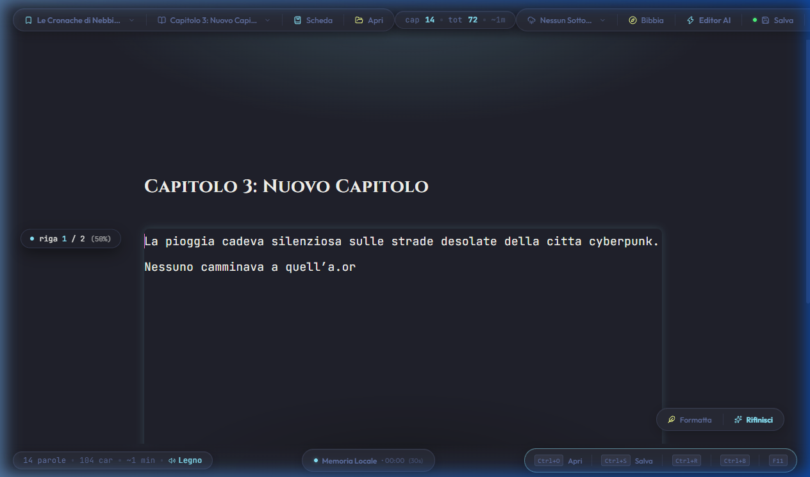
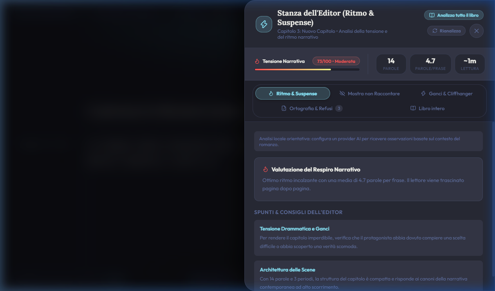
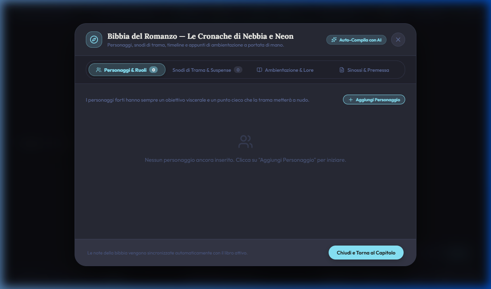
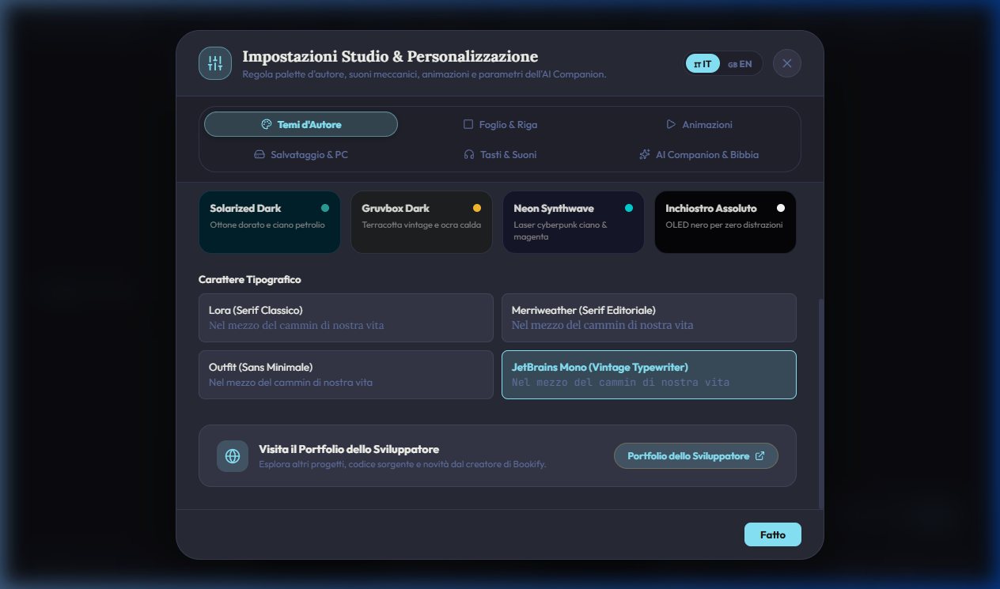

<div align="center">


# Bookify

### *The Distraction-Free Narrative Studio for Novelists*

[](https://tauri.app/)
[](https://react.dev/)
[](https://github.com)
[](https://github.com)
[](https://github.com)

<p align="center">
  <b>A desktop environment designed from the ground up for authors drafting 80,000+ word novels.</b><br>
  Immersive typewriter flow, real mechanical keyboard acoustics, an offline Novel Bible, and a nuanced AI literary editor.
</p>

[✨ Key Features](#-key-features) • [🖼️ Visual Showcase](#️-visual-showcase) • [🛠️ Architecture](#️-architecture--local-first) • [🚀 Build from Source](#-build-and-run-locally) • [👤 Developer](#-developer--portfolio)

---

</div>

## 🌌 Why Bookify?

Most writing software falls into two traps: either it's an overloaded word processor with bloated menus, or a barebones markdown notepad that abandons you when managing complex plots, deep lore, and pacing across 40 chapters.

**Bookify bridges the gap.** Built as a native desktop application with **Tauri v2** and **React**, Bookify delivers sub-millisecond input latency, sensory acoustic feedback, and deep continuity tracking while keeping your manuscript 100% private on your own disk.

---

## 🖼️ Visual Showcase

### 1. The Distraction-Free Flow Studio
> *The entire interface gracefully fades away while you type, leaving only your prose centered in focus.*

<div align="center">
  
</div>

<br>

### 2. The Editor's Room (*La Stanza dell'Editor*)
> *Deep literary diagnostics: pacing curve scores, "Show Don't Tell" filter word detection, narrative craft advice, and high-octane cliffhanger generation.*

<div align="center">
  
</div>

<br>

### 3. The Novel Bible (*Continuità Narrativa*)
> *Track characters (goals, fatal flaws, arcs), locations, and key turning points without leaving your workspace. Includes auto-extraction from chapter text.*

<div align="center">
  
</div>

<br>

### 4. Acoustic Soundscapes & Multi-Language Settings
> *Curated mechanical switch profiles (Purple Lavender, Akko, Thock, Typewriter), ambient tracks, and bilingual English/Italian toggle.*

<div align="center">
  
</div>

---

## ✨ Key Features

| Feature | Description |
|---|---|
| ⌨️ **Sensory Typing Acoustics** | Studio-grade physical audio engine featuring **Purple Lavender**, Akko CS, Thock, Topre, and vintage Typewriter switches, synced to every keypress. |
| 🌧️ **Ambient Soundscapes** | Built-in binaural audio tracks (Gentle Rain, Cozy Fireplace, Night Cafe, Library Alpha Waves) to induce deep writing flow. |
| 📖 **Novel Bible Companion** | Keep tabs on characters, world lore, and plot beats. Auto-compiles entities using local heuristics or remote LLMs. |
| 🔍 **The Literary Editor's Room** | Evaluates chapters against narrative pacing, passive filter verbs, consecutive repetitions, and emotional resonance. |
| ⚡ **Cliffhanger Generator** | Analyzes chapter endings and crafts three distinct suspense hooks (Enigma, Physical Peril, Dramatic Dilemma). |
| 🔒 **Local-First & Native Files** | Real-time autosave directly to your computer's filesystem (`.bookify` / `.json`). Zero cloud lock-in. |
| 🌐 **Bilingual English & Italian** | Complete native localization for UI, typographic conventions, and specialized LLM prompts. |
| 🪶 **Bestseller Formats Export** | One-click export for individual chapters or entire manuscripts formatted in clean Markdown (`.md`) and Plain Text (`.txt`). |

---

## 🛠️ Architecture & Local-First

- **Engine**: [Tauri v2](https://tauri.app/) (Rust backend for instant startup, minimal RAM footprint ~40MB, and direct OS file integration).
- **Frontend**: [React 19](https://react.dev/) + [Vite](https://vitejs.dev/) with Material 3 Expressive motion tokens.
- **Audio Core**: Web Audio API synthesis and low-latency sample playback buffer.
- **AI Compatibility**: Zero-setup offline heuristics + optional BYOK integration (Google Gemini, OpenAI, or local Ollama).

---

## 🚀 Build and Run Locally

### Prerequisites
1. **Node.js** (v18 or higher) & `npm`
2. **Rust & Cargo** (required for Tauri compilation): [Install Rust](https://www.rust-lang.org/tools/install)
3. Windows C++ Build Tools (on Windows) or standard Xcode/GCC tools (on macOS/Linux).

### Quickstart

```bash
# 1. Clone the repository
git clone https://github.com/your-username/Bookify.git
cd Bookify

# 2. Install dependencies
npm install

# 3. Launch in Desktop Development Mode (Tauri)
npm run tauri:dev

# Alternatively, run purely in the web browser
npm run dev
```

### Packaging Desktop Installers (`.exe` / `.msi`)

To compile the release bundle for your operating system:

```bash
npm run tauri:build
```

The compiled standalone executable and installer will be generated in:
`src-tauri/target/release/bundle/msi/` and `src-tauri/target/release/bundle/nsis/`.

---

## 🗺️ Roadmap to Public Release

- [x] **v1.0-alpha**: Distraction-Free Flow Mode & Typewriter Scrolling
- [x] **v1.1**: Purple Lavender Switch Audio Engine & Soundscapes
- [x] **v1.2**: Novel Bible & Chapter Review AI Companion
- [x] **v1.3**: Complete Bilingual Localization (IT/EN) & Tauri v2 Migration
- [ ] **v1.4**: Global Manuscript Search & Replace across all chapters
- [ ] **v1.5**: Direct standard DOCX / ePub manuscript export
- [ ] **v2.0**: Official Public Release with signed Windows `.msi` and macOS `.dmg`

---

## 👤 Developer & Portfolio

Created with passion for literature and high-performance software engineering.

- **Developer Portfolio**: [Visit Portfolio](https://github.com)
- **Feedback & Community**: Open an [Issue](https://github.com) or join the discussion.

---

<div align="center">
  <sub>Designed for dreamers, storytellers, and worldbuilders. If you like Bookify, please consider starring ⭐ this repository!</sub>
</div>
