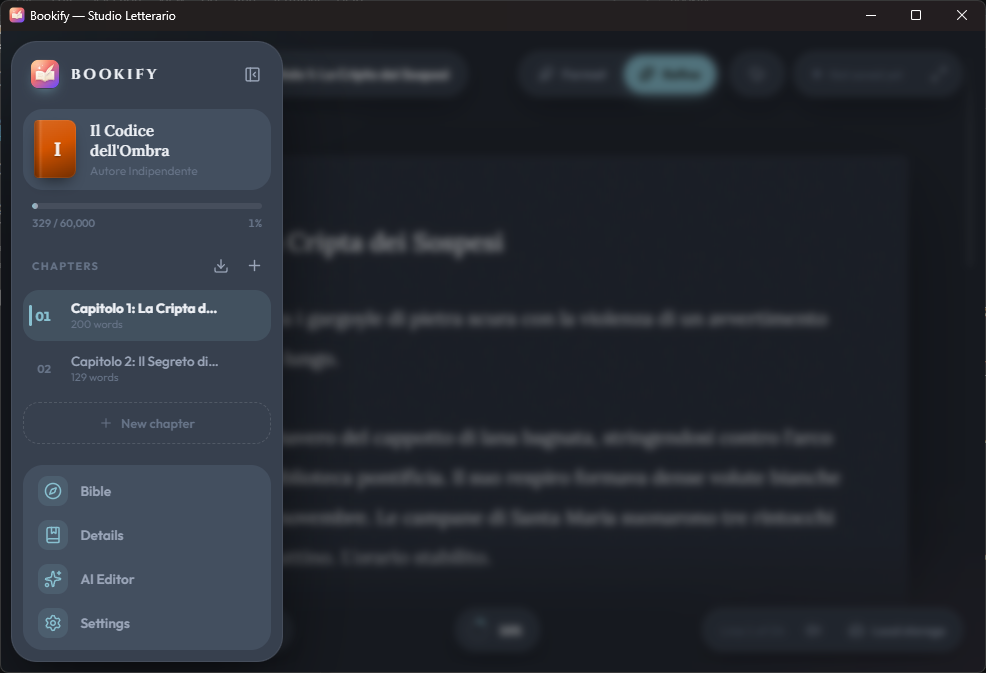

<div align="center">


# Bookify

**A cozy, distraction‑free desktop studio for writing novels.**

Floating Material‑style interface, mechanical keyboard sounds, a living Novel Bible<br>
and an AI literary editor powered by Claude, Gemini, OpenAI or a local Ollama model.

[](https://tauri.app/)
[](https://react.dev/)
[](https://github.com/Violet-owo/Bookify/releases)
[](https://github.com/Violet-owo/Bookify/releases)
[](#-ai-editor)
[](#-features)
[](LICENSE)

[**Download**](https://github.com/Violet-owo/Bookify/releases) · [Features](#-features) · [Screenshots](#-a-closer-look) · [AI editor](#-ai-editor) · [Build](#-build-from-source) · [Author](#-author)

<br>


</div>

<br>

## 🌙 Why Bookify

Most writing apps are either overloaded word processors or bare notepads that leave you alone with forty chapters, a dozen characters and a plot you have to keep in your head.

Bookify sits in between. It is a native Windows app (Tauri + React) that opens in a second, stays out of your way while you write, and keeps your characters, plot beats and pacing one click away. Your manuscript lives in a plain `.bookify` file on your own disk, and nothing leaves your PC unless you ask the AI for help.

## ✨ Features

**Writing**
- **Flow mode:** while you type, the floating pills fade out and only the page stays. Move the mouse and everything comes back.
- **Typewriter line focus:** the current line stays centred and the rest of the page softly dims.
- **Smart typography:** curly quotes, em dashes and ellipses as you type, following Italian or English conventions.
- **One‑click formatting** (`Ctrl+Shift+F`): fixes paragraphs, punctuation and dialogue to publishing standards. `Ctrl+Z` undoes it.
- **Goals and stats:** words, characters, reading time, a daily goal ring and progress towards the book target.

**Atmosphere**
- **12 author themes:** Parchment, Serika, Dracula, Nord, Botanical, Espresso, Carbon, Terminal, Solarized, Gruvbox, Synthwave and Ink.
- **Mechanical keyboard sounds:** Purple Lavender, Holy Panda, Topre, IBM Model M, an Olivetti typewriter and more.
- **Ambient soundscapes:** rain on the window, library fireplace, literary café, autumn wind, lo‑fi vinyl and alpha waves.
- **Offline fonts:** Lora, Merriweather, Outfit, JetBrains Mono and others are bundled, so nothing loads from the internet.

**Interface**
- Floating pills and a docked sidebar in a Material You / Pixel style, with tonal surfaces and spring physics.
- Ripples, sliding selection indicators and a small animation on every icon.
- **Circular theme reveal:** the new theme spreads out from the button you clicked.
- **Animation speed** set in Settings applies to every transition, and you can switch animations off entirely.
- Fully responsive: below 1100 px the sidebar becomes a sliding sheet.

**Your work**
- **Bookshelf** with multiple novels, cover cards and per‑book progress.
- **Every book linked to its own file.** Autosave writes atomically (temp file + rename), so a crash never leaves a half‑written manuscript.
- **Export** chapters or the whole manuscript as Markdown or plain text, plus full JSON backups.
- **Novel Bible:** characters (goal, blind spot, voice), plot beats, setting and synopsis, always in sync with the active book.
- **Italian and English** interface, switchable at any time.

## 🖼 A closer look

<table>
  <tr>
    <td width="50%"></td>
    <td width="50%"></td>
  </tr>
  <tr>
    <td align="center"><sub><b>Themes:</b> twelve palettes with a sliding highlight</sub></td>
    <td align="center"><sub><b>Theme reveal:</b> the new palette grows out of the clicked card</sub></td>
  </tr>
  <tr>
    <td></td>
    <td></td>
  </tr>
  <tr>
    <td align="center"><sub><b>Editor's Room:</b> pacing, show‑don't‑tell, cliffhangers and typos</sub></td>
    <td align="center"><sub><b>Novel Bible:</b> characters, plot beats, setting and synopsis</sub></td>
  </tr>
  <tr>
    <td></td>
    <td></td>
  </tr>
  <tr>
    <td align="center"><sub><b>Bookshelf:</b> all your novels with their progress</sub></td>
    <td align="center"><sub><b>AI settings:</b> Claude, Gemini, OpenAI or Ollama</sub></td>
  </tr>
  <tr>
    <td></td>
    <td></td>
  </tr>
  <tr>
    <td align="center"><sub><b>Nord theme:</b> arctic slate and polar cyan</sub></td>
    <td align="center"><sub><b>Small windows:</b> the sidebar turns into a sliding sheet</sub></td>
  </tr>
</table>

## 🪄 AI editor

Every AI feature is optional. Without a key, Bookify still runs a local analysis of pacing, sentence length, filter words and repetitions.

With a provider set up, you get:

- **Refine:** rewrites the selected passage or the chapter. You review every change in a side‑by‑side diff before accepting it.
- **Editor's Room:** a critique of the chapter or of the whole book, covering tension, show‑don't‑tell, cliffhangers and typos.
- **Bible auto‑fill:** extracts characters, places and plot beats from your chapters.
- **Real‑time suggestions** (off by default): flags typos and ambiguous sentences while you pause.

### Using Claude

1. Create an API key in the [Anthropic Console](https://console.anthropic.com/settings/keys).
2. In Bookify open **Settings → AI & Bible**, choose **Claude**, paste the key and press **Verify**.
3. Pick a model:

| Model | Best for |
|---|---|
| **Claude Opus 5.5** | the highest literary quality (default) |
| **Claude Sonnet 5.5** | a balance of quality and speed |
| **Claude Haiku 5.5** | fast, inexpensive checks |

Your key is stored only on your computer and is sent only to the provider you picked. Bookify has no telemetry.

## ⌨️ Keyboard shortcuts

| Shortcut | Action |
|---|---|
| `Ctrl+S` / `Ctrl+Shift+S` | Save / Save as |
| `Ctrl+O` | Open a `.bookify` or backup file |
| `Ctrl+J` or `Ctrl+K` | Show or hide the sidebar |
| `Ctrl+L` | Bookshelf |
| `Ctrl+I` | Novel details |
| `Ctrl+B` | Novel Bible |
| `Ctrl+R` | Editor's Room |
| `Ctrl+,` | Settings |
| `Ctrl+Shift+F` | Format the chapter |
| `F11` | Full screen |
| `Esc` | Close the open panel |

## 📦 Download

Grab the latest version from the [Releases page](https://github.com/Violet-owo/Bookify/releases).

**Windows 10 / 11**
- `Bookify_1.0.0_x64-setup.exe`: the standard installer (recommended)
- `Bookify_1.0.0_x64_en-US.msi`: the MSI package

Windows already includes WebView2, so nothing else needs to be installed.

**Linux (x86‑64)**
- `Bookify_1.0.0_amd64.AppImage`: runs on most distributions. Make it executable with `chmod +x`, then start it.
- `Bookify_1.0.0_amd64.deb`: for Debian, Ubuntu and Mint
- `Bookify-1.0.0-1.x86_64.rpm`: for Fedora and openSUSE

Windows is the main platform. The Linux builds come from the same code but are tested less. On older WebKitGTK versions, theme changes are instant instead of using the circular animation.

## 🛠 Build from source

**Prerequisites:** Node.js 18+ and [Rust](https://www.rust-lang.org/tools/install), plus:
- **Windows:** the Microsoft C++ Build Tools
- **Linux:** `sudo apt install libwebkit2gtk-4.1-dev libappindicator3-dev librsvg2-dev patchelf` (or your distribution's equivalent)

```bash
git clone https://github.com/Violet-owo/Bookify.git
cd Bookify
npm install

npm run tauri:dev     # desktop app with hot reload
npm run dev           # browser only, no file system access
npm run tauri:build   # installers in src-tauri/target/release/bundle/
```

Pushing a tag such as `v1.0.1` runs the [Release workflow](.github/workflows/release.yml). It builds the Windows and Linux installers on GitHub Actions and attaches them to a draft release.

### Under the hood

| Layer | Technology |
|---|---|
| Shell | Tauri v2 (Rust): atomic file writes, native dialogs, about 40 MB of RAM |
| UI | React 19 + Vite, hand‑written CSS with Material motion tokens and the View Transitions API |
| Audio | Web Audio API, with low‑latency samples for keys and ambience |
| AI | `@anthropic-ai/sdk` (loaded lazily), Gemini, OpenAI‑compatible REST, Ollama |
| Icons | Lucide |

## 🗺 Roadmap

- [x] Flow mode, typewriter focus, keyboard sounds and soundscapes
- [x] Novel Bible, Editor's Room, Italian/English UI
- [x] **1.0:** Claude integration, floating Material UI, animated splash screen, per‑book files
- [ ] Search and replace across the whole manuscript
- [ ] DOCX and ePub export
- [x] Linux builds (AppImage, deb, rpm)
- [ ] Signed installers and macOS builds

## 👩‍💻 Author

Bookify is designed and built by **Violet M.**

<a href="https://portfolio.violetvrc30.workers.dev/"></a>
<a href="https://github.com/Violet-owo"></a>

- 🌐 Portfolio: **[portfolio.violetvrc30.workers.dev](https://portfolio.violetvrc30.workers.dev/)**
- 🐛 Bugs and ideas: [open an issue](https://github.com/Violet-owo/Bookify/issues)

The portfolio is also linked inside the app: in the footer of **Settings** and on the **Settings → Themes → The developer** card.

## 📄 License

Released under the [MIT License](LICENSE). The bundled fonts are under the SIL Open Font License.

<div align="center">
<br>
<sub>Made for dreamers, storytellers and worldbuilders. If Bookify keeps you writing, leave a ⭐</sub>
</div>
